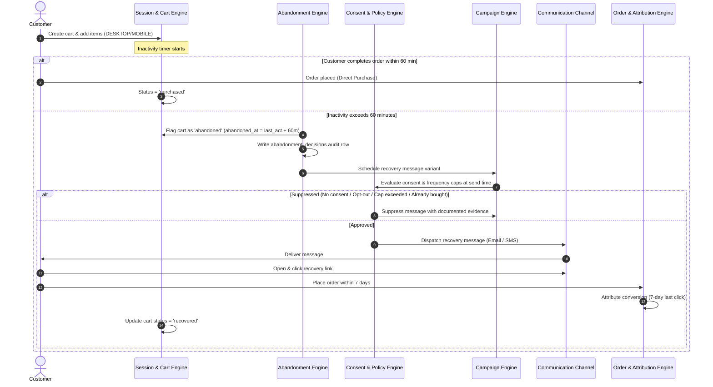

# System Architecture Documentation

## 1. Executive Architecture Overview

`CartRecover-AI` is an enterprise-grade AI Forward Deployed Engineering platform designed to automate the detection of abandoned carts, enforce strict real-time contact consent and suppression rules, schedule personalized multi-variant recovery campaigns across email and SMS channels, and execute deterministic 7-day conversion attribution.

The platform is designed around four primary architectural principles:
1. **Event-Driven Traceability**: State transitions (cart creation, quantity updates, abandonment flagging, message scheduling, sending, delivery, clicks, and orders) are recorded as immutable event rows rather than in-place overwrites.
2. **Point-in-Time Compliance**: Consent is evaluated at the exact microsecond of scheduled dispatch against a contiguous timeline of consent states.
3. **Deterministic Attribution**: Revenue is attributed using strict mathematical rules without non-deterministic heuristic leakage.
4. **Isolated Ground Truth**: Labelled operational defects and anomalies are isolated in dedicated audit records without polluting model training or analytics features.

```
+---------------------------------------------------------------------------------------+
|                                    PRIMARY ACTORS                                     |
|  [Customer]               [Merchandising Analyst]    [Store Operator]   [Ops Manager] |
+-------+-----------------------------+-----------------------+-----------------+-------+
        |                             |                       |                 |
        v                             v                       v                 v
+---------------------------------------------------------------------------------------+
|                               CartRecover-AI PLATFORM                                 |
|                                                                                       |
|   +---------------------+   +-----------------------+   +-------------------------+   |
|   | Abandonment Engine  |-->| Consent & Suppression |-->| Campaign Personalization|   |
|   | 60-min Inactivity   |   | Point-in-Time Timeline|   | Variant Rules (V1,V2,V3)|   |
|   +---------------------+   +-----------------------+   +-------------------------+   |
|              |                          |                            |                |
|              v                          v                            v                |
|   +---------------------+   +-----------------------+   +-------------------------+   |
|   | Delivery Simulation |-->| Conversion Engine     |-->| Deterministic 7-Day     |   |
|   | Open/Click/Bounces  |   | Multi-Device Returns  |   | Conversion Attribution  |   |
|   +---------------------+   +-----------------------+   +-------------------------+   |
+---------------------------------------------------------------------------------------+
        |                                                              |
        v                                                              v
+-------------------------------+                             +-------------------------+
| Relational Persistence        |                             | Visual Analytics        |
| - SQLite Embedded Database    |                             | - Streamlit Dashboard   |
| - SQLAlchemy 2.0 ORM          |                             | - Acceptance Validator  |
| - 17 Relational Tables        |                             | - Reproducibility Audit |
+-------------------------------+                             +-------------------------+
```

---

## 2. Primary Actors & Responsibilities

| Actor | Responsibilities | Key Platform Interfaces |
| :--- | :--- | :--- |
| **Customer** | Browses store, creates carts across devices, updates quantities, provides/withdraws contact consent, receives personalized notifications, converts or abandons. | Web / App storefront, Email / SMS channels, Preference Center. |
| **Store / Warehouse Operator** | Manages catalog items, verifies SKU pricing and availability, ensures inventory reservation during cart recovery windows. | Products master catalog, Inventory holding logs. |
| **Merchandising & E-commerce Analyst** | Analyzes cart abandonment rates, evaluates recovery variant conversion lifts (V1 vs V2 vs V3), tracks discount ROI, reviews customer segments. | Streamlit Dashboard (Cart Analytics, Campaign Analytics). |
| **Operations Manager** | Monitors TCPA/CAN-SPAM consent compliance, tracks message suppression rates, audits frequency cap conflicts, surveils system anomalies. | Streamlit Dashboard (Consent Monitoring, Anomaly Surveillance). |

---

## 3. End-to-End Workflow & Pipeline Execution



---

## 4. Component Architecture

### 4.1 Master & Event Data Store
- **Customer Master (`customers`)**: Unique customer demographic, contact, and regional registration.
- **Consent Timeline (`consents`)**: Contiguous, non-overlapping ledger of opt-in and opt-out actions with audit timestamps and sources.
- **Session & Device Graph (`sessions`, `cart_sessions`)**: Multi-device session linking for cross-device cart tracking.
- **Cart & Line Hierarchy (`carts`, `cart_lines`, `cart_events`)**: Fully reconciled cart items with audit trail of additions and modifications.

### 4.2 Targeting & Policy Execution Engine
- **Inactivity Evaluator**: Enforces strict time-based boundary logic ($t_{\text{order}} \le t_{\text{last\_act}} + 60\text{m} \implies$ Not Abandoned; $> +60\text{m} \implies$ Abandoned).
- **Consent Gatekeeper**: Verifies point-in-time channel authorization (`EMAIL` vs `SMS`).
- **Quiet-Hours Postponement**: Automatically reschedules SMS attempts between 21:00 and 08:00 to 08:00 local time.
- **Rolling Window Frequency Capping**: Prevents customer fatigue by enforcing a maximum of 1 message per 24 hours and 3 messages per 7 days across all channels.

### 4.3 Attribution Engine
- **Deterministic Last-Click**: Matches order to the most recent qualifying click event within 168 hours (7 days) for the same cart/customer.
- **Deduplication Assurance**: Exactly one primary attribution per order in valid operation; prevents multi-campaign revenue double-counting.
